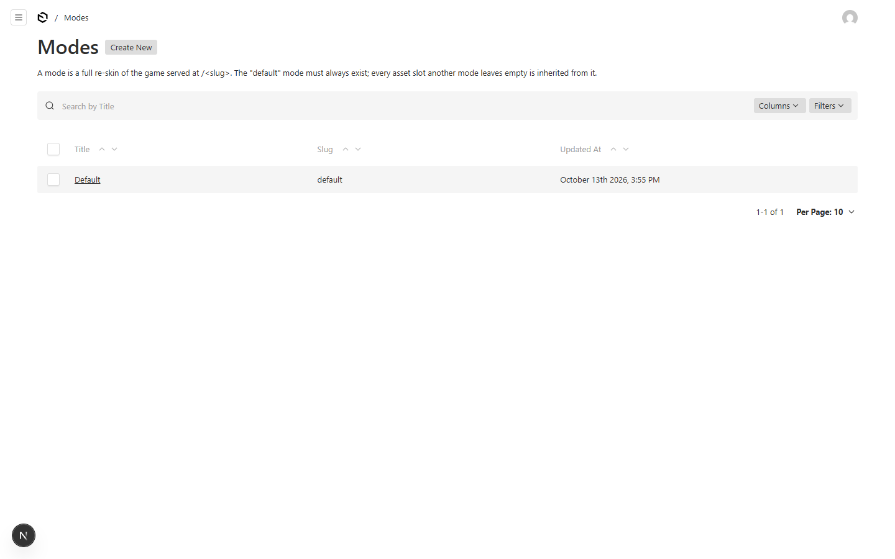
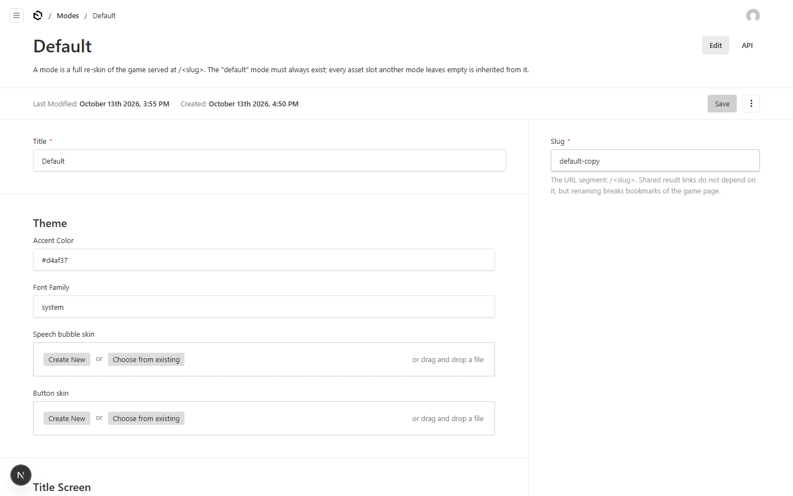
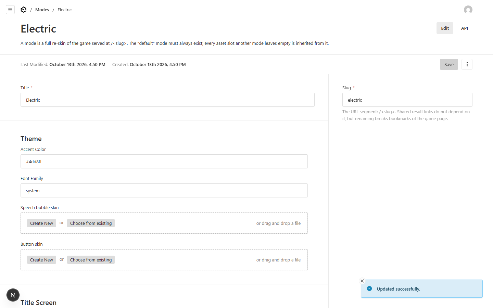
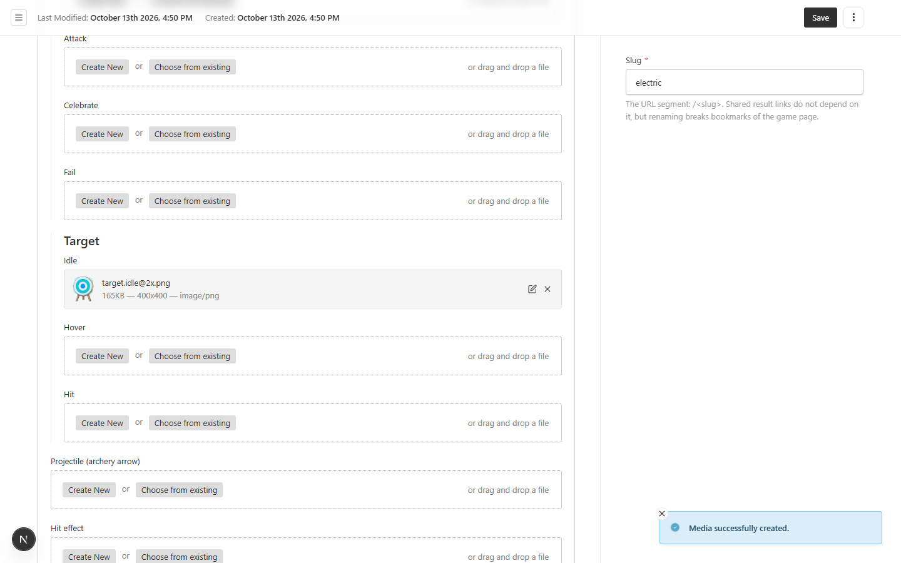
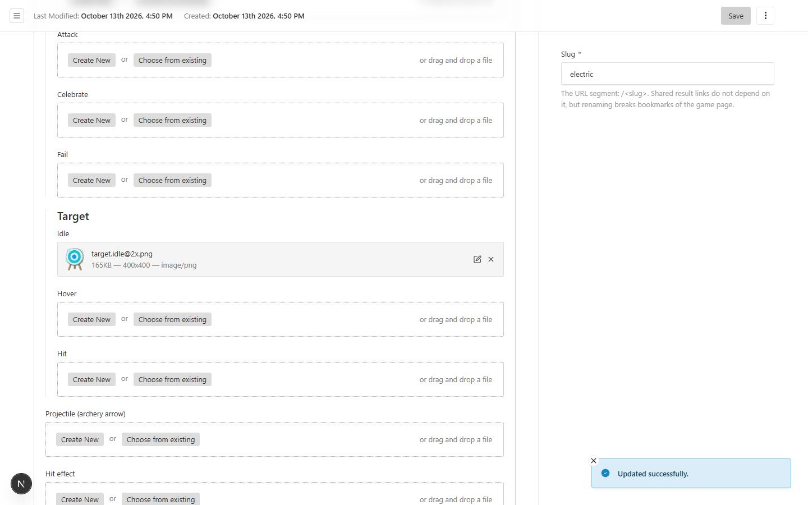
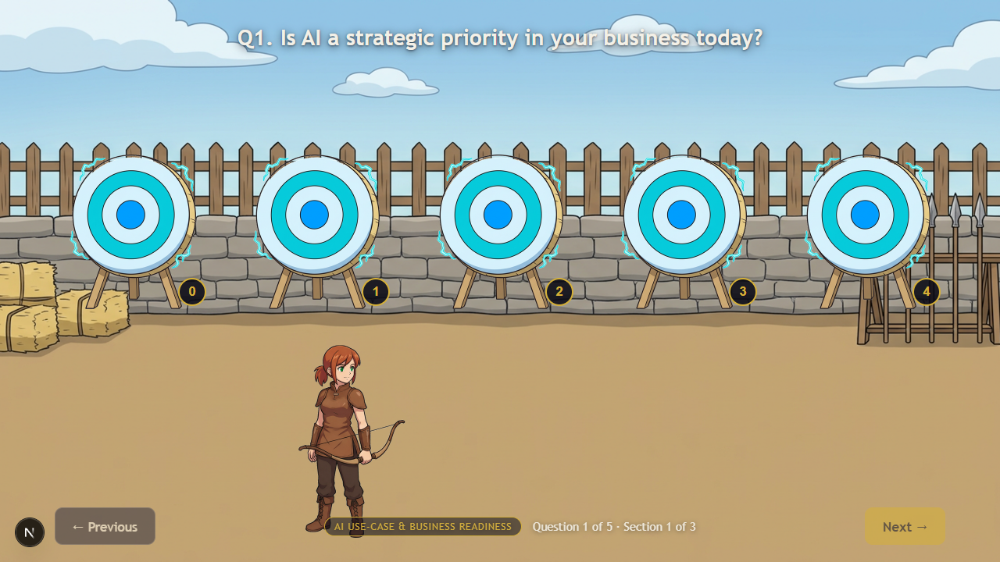
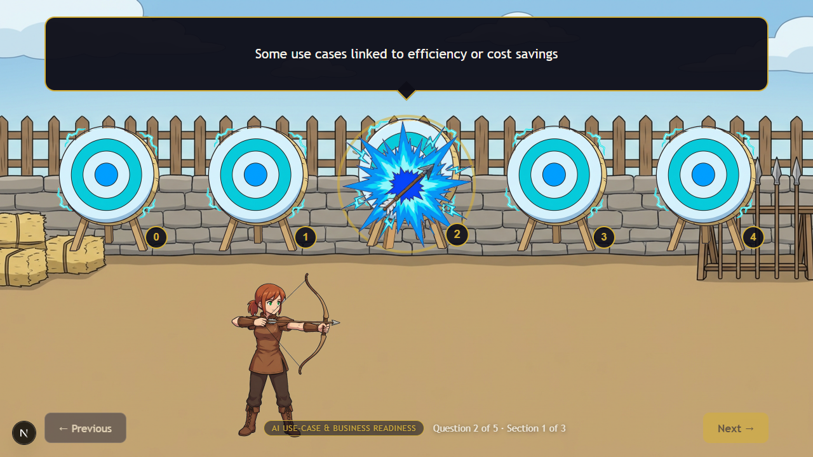
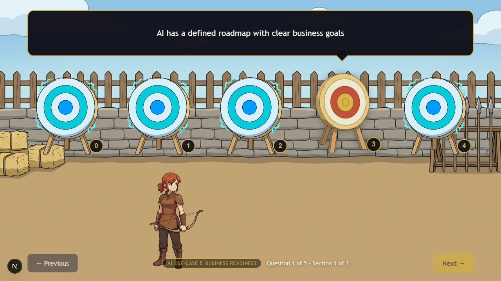

# Modes — how to ship a new skin of the game

A **mode** is one full re-skin of the training game, served at its own URL: `/<slug>` (the
`default` mode is at `/default` — `/` redirects there; `electric` is at `/electric`). A mode
carries its training content (sections, questions, band copy), its theme (accent colour, font) and
its art.

**The golden rule: empty slots inherit from `default`.** You never have to upload a full art set
to go live — upload what you have, and every slot you leave empty renders the default art. A mode
with a single uploaded image is still fully playable. (`default` itself must always exist and must
always be complete; never edit it while experimenting.)

This guide is the walkthrough we actually ran to ship the `electric` mode — every screenshot below
is from that run. You can replay it with `node scripts/re-skin-proof.mjs phase1` (see "Replaying
this guide" at the bottom). `electric` has since been *completed* (M11 wired the full 40-file set,
so `/electric` renders zero default art) — the fallback rule below is still exactly how every mode
resolves, and it is re-proven on a throwaway mode by `pnpm art:verify-fallback`.

---

## Part 1 — Ship a new mode (the 10-minute path)

You need: an admin login (`/admin`) and the image files you want to use.

**1. Start from a duplicate of `default`, never from a blank page.**
Open `/admin` → **Modes** → click the row whose **slug is `default`** (open that row, not the first
row — the list is sorted by recency, not by name).

**2. Duplicate it.** In the three-dot menu at the top right of the edit screen, click
**Duplicate**.

A new copy opens. Its slug will read `default-copy` (or `default-copy-2`, `-3`… if that name is
taken). The copy carries the training content and theme; art slots intentionally start **empty** —
that is the point.

**3. Rename it.**
- **Title** — what players see (e.g. `Electric`).
- **Slug** — the URL segment, lowercase letters/numbers/dashes (e.g. `electric` → `/electric`).
- **Theme** (optional) — accent colour and font.

Then click **Save**. The mode is now live: open `/<slug>`. If you skip the rename, it stays at
`/default-copy` — renaming the slug **later** works but breaks bookmarks, so do it now.

**4. Upload your art, slot by slot.**
Open the **Training sections** block and click the **Show All** button on its header (rows render
collapsed and fill in as you scroll — that is normal). In a section, find the slot you want, e.g.
**Target → Idle**, and click **Create New**:

- drop in the image file (or choose one),
- fill **Alt text** — a short description for screen readers, required (e.g.
  `Electric re-skin — archery target, idle`),
- click **Save** in the drawer that opened. The slot now shows your image.

**5. Save the mode again** (top-right **Save**). That is it — **upload only what you have.** In the
`electric` run above we uploaded exactly one file (the archery target idle) and left all 42 other
slots empty.

**6. Play it.** Open `/<slug>` and run through the game. Your uploads render where you put them;
everything else is default. This is the `electric` mode with one uploaded asset (recorded during
the M9 proof — `electric` has since been completed by M11):

**7. Add more later** by repeating steps 4–5 — or, for a whole set shipped from disk at once, run
`pnpm art:wire <slug>` (Part 5). M11 took `electric` from three files to the complete set; this
shot is from the M9 three-file state, kept as the walkthrough's evidence:

---

## Part 2 — What "falls back to default" means exactly

Fallback happens **per slot**, not per mode. Every image slot resolves independently: your upload
if you made one, otherwise `default`'s image. You can mix and match forever.

A fun consequence, straight from the M9 `electric` run: only the **target idle** was uploaded, so
hovering a target shows… the **default golden target** — because we never uploaded a hover image.
Same mode, same scene, two slots, two different sources:

Since M11 completed `electric`, that exact mix is re-proven on a **throwaway scratch mode**:
`pnpm art:verify-fallback` duplicates `default`, uploads exactly one electric asset, plays the
entire game asserting the mix (the upload everywhere it applies, default URLs everywhere else),
and deletes the mode again — even when the run fails. We chose the throwaway-scratch route over
keeping one named slot deliberately empty, so the shipped `electric` mode carries no permanent
holes. Screenshots: `docs/modes-proof/verify-scratch-*.png`.

The same applies to text and theme: the duplicate already carries the questions, band copy and
prompts, so a brand-new mode needs no wording work unless you want it.

**Art sizes** (all @2x, transparent PNG): targets & hit effects 400×400 · knight poses 600×520 ·
backgrounds 2560×1440 · band beats 2560×1440 · projectile 240×68 · results knight 264×264 · logo
680×240. The full prompt-and-processing recipe is in `docs/art-prompts.md`.

---

## Part 3 — Editing, replacing, removing

- **Replace a file in a slot**: open the slot's field, click the pencil on the thumbnail, upload
  the replacement, save the drawer, save the mode.
- **Clear a slot back to default**: click the **×** on the thumbnail, save. The slot inherits from
  `default` again.
- **Edit text anywhere** (questions, options, band copy): edit in place and save. One exception —
  the **question key** fields. Stored answers reference them; never change a key once players have
  runs on the mode.
- **Delete a mode**: open it → three-dot menu → **Delete**. Results already written for players
  keep working (they store their own copy of the name and scores); the game URL stops existing.
- **Rename the slug**: allowed, but shared links to `/<old-slug>` stop working. Result permalinks
  (`/result/<id>`) are unaffected.

## Part 4 — Gotchas

- **"Value must be unique"** on Save: the slug is taken by another mode. Pick a different slug (or
  delete the older mode first).
- **Uploaded files keep their original filename.** Two different modes can upload two different
  files with the same name — the CMS stores them separately. Nothing to manage here; it just
  explains why the media library may show look-alike entries. (The `pnpm art:wire` path avoids the
  ambiguity entirely: it prefixes each upload with the mode slug, e.g. `electric-archery-…`.)
- **Before you start a re-skin, do NOT edit `default`.** Always duplicate first.
- **The `default` mode must stay complete** — it is what every other mode leans on.

## Part 5 — Replaying this guide (for the technically curious)

The entire walkthrough above is automated, and the scripts are the reference implementation of the
operator flow:

- `node scripts/re-skin-proof.mjs phase1` — duplicate `default` through the admin UI, rename to
  Electric, upload one asset, save; screenshots land in `docs/modes-proof/01…06`.
- `node scripts/re-skin-proof.mjs phase2` — upload the remaining two assets (screenshots `07…09`).
- `node scripts/re-skin-proof.mjs clean` — remove the `electric` mode and its uploads to rerun the
  walkthrough from scratch. Careful: this deletes the shipped `electric` mode, so only run it
  when you intend to replay M9 on a fresh database.
- `pnpm art:verify-fallback` — the M11 per-slot fallback re-proof: duplicates `default` into a
  scratch mode with exactly one uploaded asset, plays the full game asserting upload + default
  fallback scene by scene, then deletes the mode (screenshots `verify-scratch-*.png`).
- `node scripts/art/verify-electric.mjs` — the M11 full-set proof: a scripted 15-question
  playthrough of `/electric` asserting the *inverse* of the M9 claims — every rendered slot
  resolves to an `electric-*` URL, no `default` URL is reachable anywhere (img srcs and CSS
  backgrounds), no placeholder is ever visible, the questions are byte-identical to `default`'s,
  and all three bands / the dead-QWEN fallback report behave (screenshots `verify-m11-*.png`).
- `node scripts/art/process-set.mjs <set>` — turn `vibe_images/` raws into the processed
  `art/<set>/**` sprites (see `docs/art-prompts.md`).
- `pnpm art:wire <slug>` — arm a mode with a processed set from disk (`art/<slug>/**`), uploading
  media under filenames prefixed with `<slug>-` and updating the mode's asset slots (idempotent;
  `--replace` re-uploads changed files). `pnpm art:wire electric` is how M11 completed `electric`;
  run with no argument it wires `default`.
